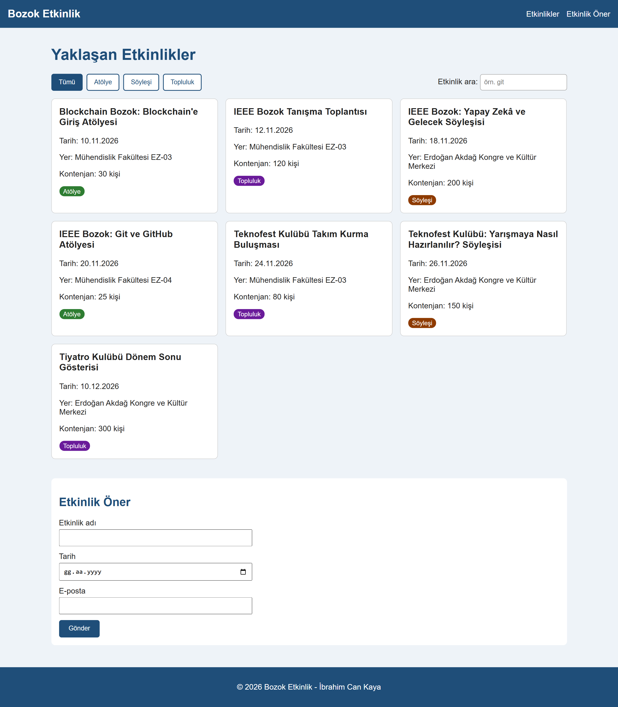

# Kampüs Etkinlik Panosu (BMH231 Ödev 2)

Yozgat Bozok Üniversitesi BMH231 Web Programlama dersi için yaptığım ödev.
Kampüsteki etkinlikleri listeleyen küçük bir web sayfası. Veriler Node.js ile yazdığım
basit bir sunucudan (sadece `http`, `fs`, `path`) JSON olarak `fetch` ile çekiliyor.

## Kurulum ve Çalıştırma

```
git clone https://github.com/IbrahimCanKaya/bmh231-odev2.git
cd bmh231-odev2
npm start
```

Sonra tarayıcıda `http://localhost:3000` adresine gidin.

## API Uç Noktaları

| İstek | Durum | Açıklama |
|---|---|---|
| GET / | 200 | Ana sayfa (public/index.html) |
| GET /api/etkinlikler | 200 | Tüm etkinlikler |
| GET /api/etkinlikler?tur=atolye | 200 | Sadece o türdeki etkinlikler |
| GET /api/etkinlikler/3 | 200 | id'si 3 olan etkinlik |
| GET /api/etkinlikler/999 | 404 | {"hata": "Etkinlik bulunamadı"} |
| Diğer yollar | 404 | Düz metin |
| GET dışı yöntemler | 405 | Düz metin, Allow: GET |

## Ekran Görüntüsü


